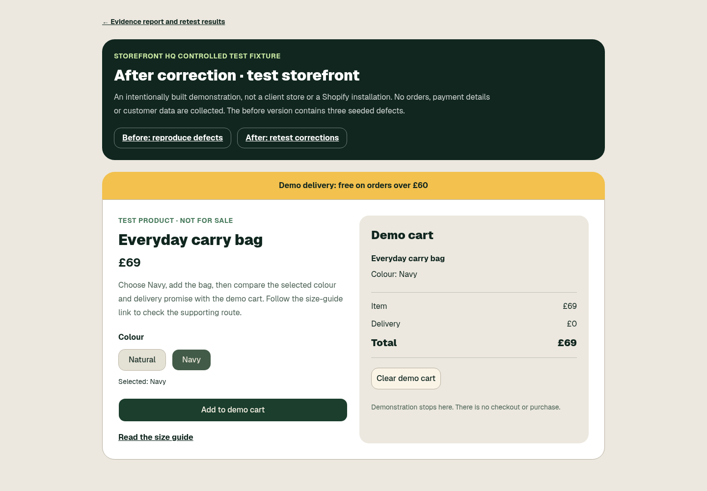

# Storefront HQ

Full-stack commerce and service-operations software for digital downloads, focused storefront services, and campaign membership. The implementation connects product configuration, signed payment events, durable orders, protected fulfilment, and operator-controlled communication.

## Review the engineering

| Area | Start here |
| --- | --- |
| Typed product catalogue and checkout gates | [lib/products.ts](lib/products.ts), [lib/config.ts](lib/config.ts) |
| Signed events and exact payment classification | [Stripe webhook](app/api/webhooks/stripe/route.ts), [lib/payments.ts](lib/payments.ts) |
| Protected digital fulfilment | [lib/digital-products.ts](lib/digital-products.ts), [download route](app/api/download/[file]/route.ts) |
| Persistence and schema evolution | [db/schema.ts](db/schema.ts), [drizzle/](drizzle/) |
| Consent-aware intake and operations | [lib/website-forms.ts](lib/website-forms.ts), [lib/pipeline.ts](lib/pipeline.ts) |
| Regression evidence | [tests/](tests/), [synthetic demonstration provenance](public/demo-evidence/verification.json) |

The stack is React, TypeScript, Vinext/Vite, Cloudflare Workers and D1, Drizzle, Tailwind CSS, and signed provider webhooks. See the [architecture](docs/architecture.md) for request boundaries and the [documentation index](docs/README.md) for operating references.



The screenshot is a controlled demonstration, not a client result or a measured conversion improvement. Integration adapters and local tests do not by themselves establish that a live provider account is configured.

## Run locally

Use Node.js 24 and npm; the lockfile records exact package resolutions.

```sh
npm ci
npm run db:migrate:local
npm run dev -- --host 127.0.0.1
```

The public interface can be reviewed without enabling payment, email, or discovery providers. Initialize the empty local D1 schema first so the Reviews page can query its tables. `db:migrate:local` uses the placeholder development binding in `wrangler.local.jsonc`, writes only to ignored `.wrangler/` state, and does not connect to a production database. Copy `.env.example` to an ignored local environment file only when configuring a specific integration. Operator routes require the configured database binding and operator identity. An unconfigured integration remains gated.

```sh
npm run verify
npm run build
```

Tests preload an offline network guard and inject synthetic provider responses. They must not charge a card, send a message, query a live customer, or consume discovery credits. A build creates local deployment output; publishing is a separate operation.

## Repository guide

- `app/` — public pages, operator screens, HTTP handlers, and webhook boundaries.
- `components/` — branded product interface and shared accessible controls.
- `lib/` — catalogue, configuration, payment classification, fulfilment, and operations logic.
- `db/` and `drizzle/` — typed persistence and versioned migrations.
- `automations/` — the separately configured Gmail bridge.
- `tests/` and `scripts/` — deterministic behavior checks and local preview checks.
- `public/` and `design/` — product assets, synthetic evidence, and visual provenance.
- `docs/` — architecture, operating instructions, and dated historical research.

## Product scope

The current catalogue serves online sellers through four bounded products:

- **Store Launch Kit — £39 one-time:** seven editable launch resources, available after confirmed payment.
- **Product Page Rescue — £79 one-time:** a focused rewrite and public review of one live product page, delivered within two business days.
- **Store Emergency Check — £99 one-time:** an evidence-backed diagnosis of one urgent public-storefront problem, with an initial diagnosis within 24 hours and one public retest after repair.
- **Seller Campaign Club — £19/month:** a monthly campaign pack of practical prompts, templates and a simple launch plan, cancellable through Stripe with no minimum term.

The canonical catalogue lives in [`lib/products.ts`](./lib/products.ts). New-customer copy, checkout configuration and fulfilment must match those names, prices, billing terms and deliverables. [`lib/offer.ts`](./lib/offer.ts) is retained only to reconcile and fulfil any genuine historical Storefront QA Sprint orders; that offer is retired for new customers.

## Checkout and fulfilment safety

- A product is not buyable until its exact live Stripe Payment Link URL and object ID are configured together with the public legal seller name and trading/postal address.
- A success-page visit or payment email is not proof of payment. The Stripe webhook must match live mode, the configured Payment Link ID, GBP currency and the exact product amount.
- Digital downloads require a cleared, deduplicated Storefront HQ order.
- Service work starts only after a safely matched cleared order. Storefront HQ works from public URLs and does not require merchant-admin access.
- The `/start` form is an enquiry route only. It does not verify email ownership or grant permission for an automated email.

## What is automated

- Enquiry capture, suppression and consent-aware Gmail thread handling
- Signed Stripe and booking webhook handling
- Exact per-product payment classification and durable `commerce_orders`
- Protected launch-kit and member-pack downloads after confirmed payment
- Service onboarding from the confirmed-order success page
- Six-hour operations monitoring and one ordinary-web buyer-intent discovery pass per UTC day
- Historical payment and delivery reconciliation for genuine prior orders

## What is deliberately not automated

- Cold email, scraped contacts or unsolicited public posting
- Publishing marketplace, community or social replies without human approval
- Discounts, custom scope, refunds, disputes or legal/tax decisions
- Claims of guaranteed conversion or revenue uplift
- Unlocking a download or starting work from an unverified payment signal
- Firecrawl spending for routine monitoring, discovery or diagnostics

See the [operating runbook](docs/operations/runbook.md) for the operating plan and [Gmail bridge setup](automations/google-apps-script/SETUP.md) for the dedicated integration. Historical research is separated from current operating instructions in [docs/history/](docs/history/).

Commercial prices and deliverables are controlled by the catalogue, not by this repository cleanup. Production account configuration, payment settlement, external delivery, and business outcomes require separate operational verification.
