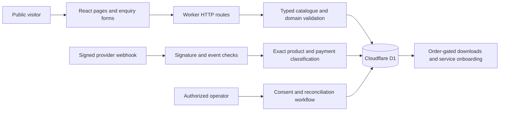

# Architecture

Return to the [project overview](../README.md).

## Request paths

`app/` owns presentation and HTTP boundaries. `lib/` owns catalogue rules, configuration gates, payment classification, fulfilment, and operational transitions. `db/schema.ts` describes persistence; `drizzle/` records migration history.

## Decisions to inspect

- A checkout redirect is informational. A signed, deduplicated event must match live mode, the configured Payment Link, GBP currency, and the expected product amount before an order unlocks fulfilment.
- Unmatched cleared money enters reconciliation instead of silently starting work.
- Downloads are tied to a cleared order. Public forms collect enquiries and do not establish payment or email ownership.
- Communication has separate consent, operator-identity, suppression, and deduplication gates. A production mail account and its permissions must be configured separately.
- Migrations, mock event fixtures, and deterministic tests remain reviewable alongside the implementation.

## Verification boundary

`npm test` preloads the offline fetch guard in `tests/deny-network.mjs`. Tests replace providers with explicit fixtures and verify domain outcomes. `npm run lint` performs the configured type-aware source checks. `npm run build` compiles the Worker and client outputs.

Local checks establish software behavior with test data. Live payment settlement, external mail delivery, provider permissions, production database migrations, and business performance require their own authorized operational verification.
